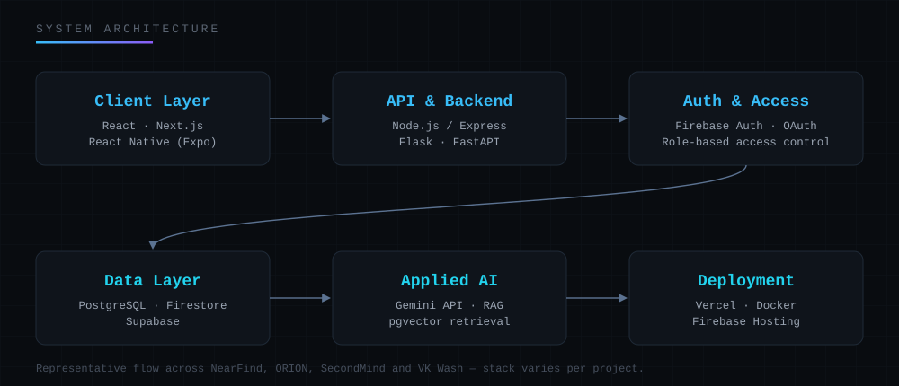

  

Full-stack and backend engineer building production systems — real-time marketplaces, role-based platforms, and AI-native applications powered by RAG and LLM pipelines.

  
  
  

 

## About

Computer Science undergraduate at IIIT Kottayam who ships complete systems end to end — frontend, backend, database and deployment. Most of my work has gone into production platforms used by real customers: a hyperlocal commerce app with live order tracking, a client-facing laundry booking service processing real payments, and an AI campus assistant built on a retrieval-first RAG architecture. Comfortable moving between React/React Native interfaces, Node/Flask/FastAPI services, SQL and NoSQL data layers, and Gemini-powered AI workflows.

 

## Engineering Focus

<table>
<tr>
<td width="50%" valign="top">

**Full-Stack Systems**
End-to-end products — responsive interfaces wired to REST APIs, authentication and databases, shipped to real users rather than left as demos.

</td>
<td width="50%" valign="top">

**Backend Engineering**
API design, role-based access control, transaction/payment validation and workflow automation across Node.js, Flask and FastAPI.

</td>
</tr>
<tr>
<td width="50%" valign="top">

**Real-Time & Data Systems**
Firestore/Supabase-backed platforms with live order tracking, security rules, and multi-role data flows that update instantly across clients.

</td>
<td width="50%" valign="top">

**Applied AI**
Retrieval-grounded LLM features — RAG pipelines over pgvector, Gemini API integrations, and scikit-learn inference services.

</td>
</tr>
</table>

 

## Tech Stack

**Languages**
 

 C++ · Python · TypeScript · JavaScript · SQL

**Frontend**
 

**Backend**
 

**Databases & Cloud**
 

**Tools & DevOps**
 

**Applied AI**
 
Gemini API · Retrieval-Augmented Generation · Vector Search (pgvector) · LLM Workflows · Scikit-learn

 

## Featured Projects

### ORION — AI Campus Assistant
RAG-grounded campus assistant for IIIT Kottayam — answers are retrieved from Postgres and vector search first, then phrased by Gemini, never invented from model memory.

- Retrieval-first architecture: SQL + pgvector search runs before any LLM call, so Gemini explains grounded data instead of hallucinating
- FastAPI backend with Google OAuth, httpOnly session cookies, and role-based access for students, faculty, CRs and admins
- OCR ingestion pipeline (Tesseract) that turns PDFs, timetables and notices into searchable Gemini embeddings

[Repository](https://github.com/JohnsonOduri/orion-campus-nest) · [Live](https://orion-iiitk.vercel.app)
 

---

### NearFind — Hyperlocal Commerce Platform
A four-role marketplace — customer, retailer, delivery partner, admin — with live order tracking over Firestore.

- Firestore `onSnapshot` listeners drive every screen in real time, from inventory toggles to delivery status, with no manual refresh
- Role-based Firestore security rules enforce order-state transitions (placed → accepted → packed → picked up → delivered) server-side
- Multi-store cart splits a single order across retailers and resolves delivery eligibility only once every store is ready

[Repository](https://github.com/JohnsonOduri/NearFind) · [Demo Walkthrough](https://youtu.be/glEheV8mdWo)
 

---

### VK Wash — Service Booking Platform
Production booking and billing platform running real customer orders for a laundry service business.

- PhonePe payment integration with callback handling and order-status reconciliation
- Firebase-backed order, billing and service-history workflows used in daily operations
- Cloudinary-based invoice generation shared directly with customers over WhatsApp

[Repository](https://github.com/JohnsonOduri/vk-wash-web) · [Live](https://vkwash.in)
 

---

### SecondMind — AI Knowledge Platform
AI second brain that enriches saved notes with Gemini and answers questions only from what's actually been stored.

- Ingestion pipeline auto-generates summaries and tags on every note via Gemini, backed by a normalized Postgres schema
- Grounded query endpoint retrieves candidate notes by tag overlap and full-text search before asking Gemini to answer
- Public query API route for programmatic, infrastructure-style access to the knowledge base

[Repository](https://github.com/JohnsonOduri/SecondMind) · [Live](https://secondmind-altibbe.vercel.app)
 

---

### SalaryPilot — AI Salary & Career Platform
ML and AI platform that predicts salary ranges, scores resumes, and plans career switches.

- Trained scikit-learn regression model served through a Flask inference API
- Resume parsing (PyMuPDF/mammoth) feeding a skill-gap analysis and AI-generated resume score via Gemini
- Career-switch planner mapping current role and skills to salary deltas and required skills

[Repository](https://github.com/JohnsonOduri/salary-pilot-web) · [Live](https://salary-pilot-web.vercel.app)
 

 

## System Architecture

  

 

## Experience

**Freelance Software Developer** — VK Wash · Smart Tech Solutions · Bhoomi
 2024 – Present
 Shipped production web and mobile applications for business clients — backend APIs, authentication, database design and PhonePe payment integration.

**Software Project Contributor** — IBM SkillsBuild, Edunet Foundation
 Jun 2025 – Jul 2025
 Contributed to SalaryPilot — ML feature development, debugging, and AI/LLM integration as part of an industry-aligned software project.

**Technical Volunteer** — Google Developer Student Club
 Jan 2025 – Present
 Cross-functional technical support for community-run events and initiatives.

 

## Achievements

**TechSprint Winner — Google Developer Student Club**
 Won for pitching the campus platform that became ORION — unifying events, academics and AI-assisted information access for IIIT Kottayam.

 

## GitHub Activity

<table>
<tr>
<td width="50%">

</td>
<td width="50%">

</td>
</tr>
</table>

 

## Education

**Indian Institute of Information Technology Kottayam**
 B.Tech, Computer Science and Engineering · CGPA 8.32/10 · Aug 2024 – Present

 

## Contact

Open to software engineering roles and ambitious collaborations.

  
  
  

